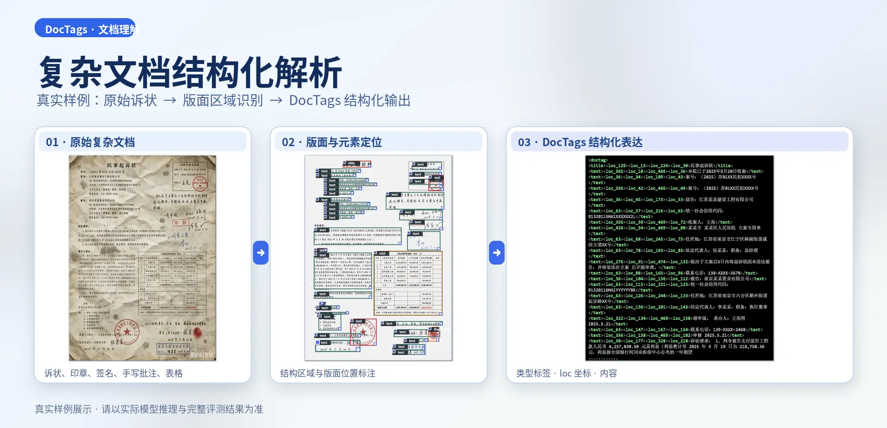

---
hide:
  - toc
shanshui_scene: 7
---

<section class="mv-showcase-v18" aria-labelledby="mv-showcase-title">
  <header class="mv-showcase-v18__intro">
    
模型展示 · MODEL SHOWCASE

    <h1 id="mv-showcase-title">自研模型展示</h1>
    
探索文档理解与视频理解的研究成果。

  </header>

  

    <article class="mv-showcase-v18__card mv-showcase-v18__card--doc" aria-labelledby="mv-showcase-doc-title">
      <figure class="mv-showcase-v18__cover">
        
      </figure>
      

        文档理解 · DocTags
        <h2 id="mv-showcase-doc-title">文档结构化解析</h2>
        
文档版面、文本、表格与阅读顺序的结构化解析。

        <a class="mv-showcase-v18__primary" href="https://multimodal-vision-ai-mvai-doctags-webgpu.static.hf.space/" target="_blank" rel="noopener noreferrer">打开 HF 在线体验 ↗</a>
        <a class="mv-showcase-v18__secondary" href="../assets/projects/doctags/interactive-demo/index.html">查看解析样例 →</a>
        
在线演示为 IBM Granite Docling 258M 公开基线，非实验室自研权重。

      

    </article>

    <article class="mv-showcase-v18__card mv-showcase-v18__card--video" aria-labelledby="mv-showcase-video-title">
      

        ▶
        视频行为理解
        打电话 · 玩手机 · 吃东西
      

      

        视觉理解 · 研究方向
        <h2 id="mv-showcase-video-title">视频行为识别</h2>
        
面向视频中的人物动作识别与分析。

        <a class="mv-showcase-v18__secondary mv-showcase-v18__secondary--prominent" href="vision-ai/index.html">了解研究方向 →</a>
        
方案展示，暂未开放实时模型体验。

      

    </article>
  

  

    
其他实验入口与技术说明

    

      <a href="doctags-browser/index.html">站内 WebGPU 实验</a>
      <a href="doctags-kaggle/index.html">Kaggle GPU 试用</a>
      <a href="document-ai/index.html">文档理解项目</a>
    

  

  <nav class="mv-showcase-v18__footer" aria-label="成果展厅更多入口">
    <a href="document-ai/index.html">文档理解</a>
    <a href="vision-ai/index.html">视觉理解</a>
    <a href="student-work/index.html">学生作品与提交指南</a>
  </nav>
</section>
