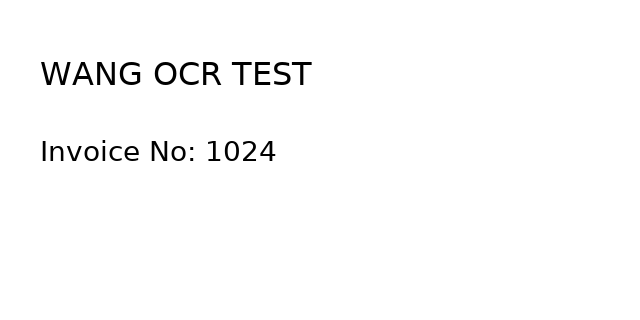

# Wang Qwen3.5 2B 实测记录

测试日期：2026-11-04。图片为本项目生成的 640 × 320 合成文档，不使用内部训练或测试图片。

## 原模型与转换校验

| 检查 | 结果 |
| --- | --- |
| 源模型 SHA-256 | `f299d2ff0d0cdd72a54232b3c4720d2f600df5a6b5ec148528579d7c7fd777e0` |
| 词表与嵌入大小 | 248,654 × 2,048 |
| added tokens 单词元、无损往返 | 610 / 610 |
| 对应 ONNX 嵌入最大绝对误差 | 0.0 |
| 输出头核对 | 包括最后词元在内的抽样与源权重 FP16 转换结果完全一致 |
| 原分词器、模板、processor、generation config | 逐字节一致 |
| 视觉三种网格相似度 | 最小 0.999998033 |

CPU 原模型使用 PyTorch 2.10.0、Transformers 5.6.2、FP32、4 个线程；本张图生成 26 个词元，耗时 19.324 秒。
转换环境独立使用 `requirements-export.txt` 中固定版本，不修改训练环境。

词嵌入和视觉图通过标准 ONNX checker。解码器使用 ORT 原生支持的 `ai.onnx::SimplifiedLayerNormalization` 扩展；标准 checker 缺少该 schema，已在 [组件报告](validation/component_validation.json) 单独记录，并通过下面的真实 WebGPU 推理补足验证。

## 原生 WebGPU

| 项目 | 结果 |
| --- | --- |
| 浏览器 | Chrome 157.0.8103.38，Linux，无头模式 |
| GPU | NVIDIA A800 80GB PCIe，物理 GPU 4，PCI A1:00.0 |
| 运行时 | Transformers.js 4.4.0-next.0 / ORT Web 1.31.1 |
| 精度 | 视觉 FP32，词嵌入与文字生成 FP16 |
| 图像网格 | 1 × 20 × 40 |
| 输入／生成词元数 | 222 / 26 |
| 本地加载 | 19.123 秒 |
| 首次识别 | 6.442 秒 |
| 再次识别 | 4.530 秒 |
| 两次实际输出 | 完全相同 |
| 与 CPU 原模型输入词元／生成词元／原始输出 | 全部逐个一致 |
| 停止生成 | 生成 1 个词元后停止，未错误标记正常结束 |
| 390px 宽显示 | 页面无横向溢出；此项只检查布局，不代表移动设备 GPU 推理 |
| 现有公共 DocTags 渲染器 | 正确解析两段文字和两个位置框 |

本次使用本地 HTTP 服务加载本地转换文件，不代表 HF 首次在线下载时间或正式展厅已集成。
使用贪心生成、重复惩罚 1.02、给定 response prefix、图片像素上限 2,073,600，本张图的输出上限设为 256。

为了遵守服务器 GPU 使用安排，Mesa 的 Vulkan 物理设备枚举强制限定为 GPU 4。
报告同时记录独立 Vulkan PCI 校验与加载前后的显存：模型分配落在 A1:00.0；另一卡上的 6 MiB 驱动初始化上下文保持不变。
无头 NVIDIA 运行使用 `vulkan_enable_f16_on_nvidia` 开关；此服务器参数不代表任意浏览器默认均已支持半精度。
测试结束后关闭自建 Chrome 和 HTTP 服务，释放测试资源。

## 图片与原始输出



```text
<think>

</think>

<doctag><text><loc_30><loc_78><loc_244><loc_139>WANG OCR TEST</text>
<text><loc_30><loc_212><loc_216><loc_260>Invoice No: 1024</text></doctag>
```

已给定的 assistant 前缀与模型实际生成的后缀分别保存在报告字段 `responsePrefix` 和 `generatedText` 中，未修补识别文字或坐标。

- [浏览器完整记录](validation/browser_validation.json)
- [CPU 原模型记录](validation/pytorch_reference.json)
- [组件数值与文件校验值](validation/component_validation.json)
- [实际 DocTags 文件](validation/output.doctags)
- [桌面截图](validation/screenshot.png)
- [390px 宽截图](validation/screenshot-mobile.png)

本记录证明该合成短页的实际功能与转换一致性；尚未重跑完整 OCR benchmark、长页、复杂表格或不同品牌设备的准确率与兼容性测试。
